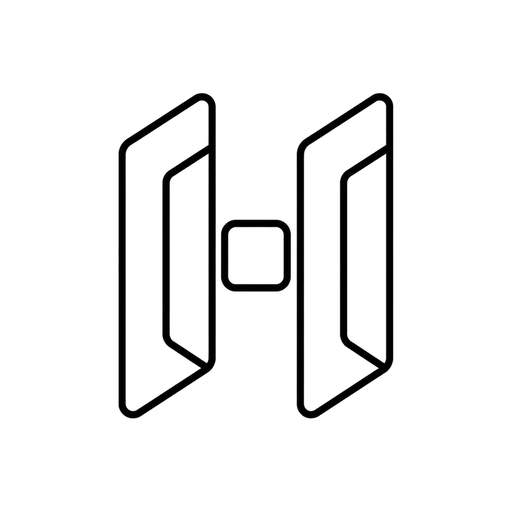

# HyperOx runtime (h0x)



The terminal runtime your coding agents live on.

`h0x` is a terminal multiplexer built for people who run several coding agents at once. A background server owns the real terminal processes; clients attach to render them, so your agents keep working whether or not a window is open.

- **Detach without stopping work.** Panes run on a background server. Close the window, log out, lose the SSH link; reattach later and the layout comes back after a restart.
- **Several machines in one window.** Saved SSH machines appear next to local workspaces, with the same panes, tabs, and agent states.
- **Never hunt for the stuck one.** Every pane reports whether its agent is `working`, `blocked` on a question, or `idle`, rolled up per workspace in the sidebar.
- **Agent-native CLI and socket API.** Agents and scripts split panes, start commands, read output, and wait for state changes through `h0x` or the local socket.
- **Runs the agents you already run.** Claude Code, Codex, Cursor, OpenCode, and more are recognized automatically, with native session restore where the agent supports it.
- **Keyboard and mouse.** Click panes, drag split borders, use right-click menus; or drive everything with a configurable prefix key.
- **Plugins.** Extend the runtime with plugins installed from the marketplace or linked from a local path.
- **One Rust binary.** No Electron, no runtime dependencies.

## Install

HyperOx is in Beta: expect rough edges and breaking changes between releases.

Linux and macOS:

```bash
curl -fsSL https://github.com/vjk7989/h0x-ADE-Runtime/releases/latest/download/install.sh | sh
```

Windows PowerShell:

```powershell
powershell -ExecutionPolicy Bypass -c "irm https://github.com/vjk7989/h0x-ADE-Runtime/releases/latest/download/install.ps1 | iex"
```

### Manual download

Pick the file for your platform from the [latest release](https://github.com/vjk7989/h0x-ADE-Runtime/releases/latest) and put it on your PATH as `h0x` (`h0x.exe` on Windows):

| Platform | Asset |
|---|---|
| Linux x86_64 / aarch64 | `h0x-linux-x86_64` / `h0x-linux-aarch64` |
| macOS Intel / Apple Silicon | `h0x-macos-x86_64` / `h0x-macos-aarch64` |
| Windows x86_64 | `h0x-windows-x86_64.zip` |

### Verify a download

Every release file has a [minisign](https://jedisct1.github.io/minisign/) signature beside it (`<file>.minisig`, same folder). The public key is:

```text
RWTEdqtOBn6VKQ/x9x3qWk/gIWUb/I1OlZXsTlHyrkp9Yq30qBki+tdt
```

```bash
base=https://github.com/vjk7989/h0x-ADE-Runtime/releases/latest/download
curl -fsSLO $base/h0x-linux-x86_64
curl -fsSLO $base/h0x-linux-x86_64.minisig
minisign -Vm h0x-linux-x86_64 -P RWTEdqtOBn6VKQ/x9x3qWk/gIWUb/I1OlZXsTlHyrkp9Yq30qBki+tdt
```

`h0x update` checks these signatures itself.

## Get started

```bash
h0x          # start the server and attach to the default session
# ctrl+b q   # detach; everything keeps running
h0x          # reattach
```

The prefix key is `ctrl+b`: press it, then an action key (`v` splits right, `c` opens a new tab). The mouse covers everything too.

## Docs

- [Quick start](docs/next/website/src/content/docs/quick-start.mdx)
- [Concepts](docs/next/website/src/content/docs/concepts.mdx): sessions, workspaces, tabs, panes, agents, modes
- [Agents](docs/next/website/src/content/docs/agents.mdx): supported agents and integrations
- [Keyboard](docs/next/website/src/content/docs/keyboard.mdx)
- [Configuration](docs/next/website/src/content/docs/configuration.mdx)
- [Session state](docs/next/website/src/content/docs/session-state.mdx): what survives a detach, restart, or update
- [Connecting machines](docs/next/website/src/content/docs/connecting-machines.mdx): SSH machines in one window
- [Plugins](docs/next/website/src/content/docs/plugins.mdx)
- [Socket API](docs/next/website/src/content/docs/socket-api.mdx)

## Agents

Print the bundled agent skill and hand it to the agent running inside a pane:

```bash
h0x --skill
```

The same file lives at [`skills/h0x/SKILL.md`](skills/h0x/SKILL.md). It teaches an agent to verify it is inside a HyperOx pane (`H0X_ENV=1`), split panes, start and prompt other agents, read output, and wait for state changes.

Contributors and agents working on this repository should read [`AGENTS.md`](AGENTS.md) and [`CONTRIBUTING.md`](CONTRIBUTING.md).

## Development

```bash
git clone https://github.com/vjk7989/h0x-ADE-Runtime.git
cd h0x-ADE-Runtime
cargo build --release
just test     # cargo nextest + maintenance script tests
just check    # formatting, lints, tests, Windows cross-compile
```

Debug builds use the `h0x-dev` config directory and socket so they never touch a stable install on the same machine.

## Part of HyperOx

HyperOx is three components that share one agent model:

- **HyperOx runtime (`h0x`)**: this repository, the terminal multiplexer.
- **HyperOx desktop app (`h0x-ade`)**: https://github.com/vjk7989/h0x-ADE-app
- **HyperOx core (`h0x-core`)**: https://github.com/vjk7989/h0x-ADE-core, the headless terminal runtime the app is built on.

## License

Apache-2.0. See [LICENSE](LICENSE) and [NOTICE](NOTICE) for bundled third-party components.
